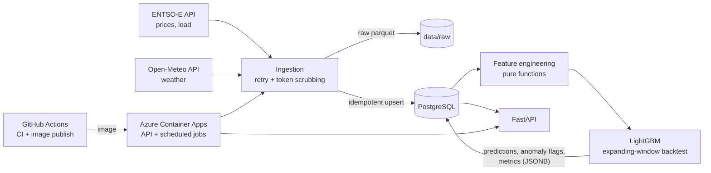

# nl-energy-pipeline

An end-to-end data pipeline on public Dutch energy data: it pulls day-ahead electricity prices and
grid load from [ENTSO-E](https://transparency.entsoe.eu/) plus weather from
[Open-Meteo](https://open-meteo.com/), stores everything in PostgreSQL, trains a LightGBM
price forecaster with a leakage-safe time-series backtest, flags anomalous price hours from the
forecast residuals, and serves the results through a FastAPI service. The whole thing is packaged
with Docker, tested in GitHub Actions against a real Postgres, and ingests new data on a schedule.



## Results

Backfilled 2024-01-01 to 2026-10-21 (about 175k raw rows: 52k price points, 98k load points, 25k hourly
weather rows) and trained on 24,422 complete hourly samples. Scores are **out-of-sample** from a 5-fold
expanding-window backtest (20,350 forecast hours, 2024-06 to 2026-10):

| Model | MAE (EUR/MWh) | RMSE (EUR/MWh) |
|---|---|---|
| **LightGBM** | **22.6** | **35.1** |
| Same hour yesterday | 27.4 | 43.6 |
| Same hour last week | 33.5 | 53.0 |

That is 17% lower MAE than "same hour yesterday" and 32% lower than "same hour last week". The most useful
features by gain are yesterday's price (42%), last week's price (17%) and wind speed (10%).

The anomaly detector flagged 365 of 20,350 hours (1.8%). The largest residuals are extreme price hours,
for example 2024-12-12 16:00 UTC (actual 873 vs. forecast 256 EUR/MWh) and 2026-05-01 11:00 UTC (actual -498
vs. forecast -28 EUR/MWh). Negative prices are common in the data (2,753 hours), so prices are modelled on
their natural scale rather than log-transformed.

## Quickstart

Requirements: Python 3.12+, [uv](https://docs.astral.sh/uv/), and a free
[ENTSO-E API token](https://transparency.entsoe.eu/) (only needed for ingestion).

### With Docker

```bash
cp .env.example .env                       # add ENTSOE_API_TOKEN
docker compose up --build -d               # Postgres + API (migrations run on start)
docker compose run --rm ingest             # last 7 days
docker compose run --rm ingest nl-energy-pipeline ingest --start 2024-01-01 --no-parquet   # full backfill
docker compose run --rm train
open http://localhost:8000/docs
```

### Without Docker

```bash
uv sync
cp .env.example .env                       # add ENTSOE_API_TOKEN
uv run python scripts/dev_db.py            # throwaway local Postgres, prints its DATABASE_URL
export DATABASE_URL=...                    # the URL printed above (or your own Postgres)
uv run alembic upgrade head
uv run nl-energy-pipeline ingest --start 2024-01-01
uv run nl-energy-pipeline train
uv run uvicorn nl_energy_pipeline.api.main:app
```

LightGBM needs the OpenMP runtime on macOS (`brew install libomp`).

### Development

```bash
uv run ruff check . && uv run ruff format --check .
uv run pytest                              # spins up a private Postgres automatically (pgserver)
```

## API

| Endpoint | Returns |
|---|---|
| `GET /health` | `{"status": "ok"}`, or 503 when the database is unreachable |
| `GET /prices?start&end&limit` | Day-ahead prices (EUR/MWh); defaults to the last 7 days |
| `GET /predictions?start&end&limit` | Out-of-sample forecast vs. actual price per hour |
| `GET /anomalies?start&end&limit` | Hours whose forecast residual was flagged as extreme |
| `GET /model` | Latest model version, training size and backtest metrics |

Timestamps are ISO-8601, naive values are read as UTC. Interactive docs are at `/docs`.

## Design decisions

| Decision | Why |
|---|---|
| **Store timestamps as UTC `timestamptz`; derive calendar features in `Europe/Amsterdam`** | Avoids DST ambiguity in storage and joins, while hour-of-day / holiday effects still follow local behaviour. |
| **Every write is `INSERT ... ON CONFLICT DO UPDATE`** | Re-running a window, retrying after a crash, or the daily job re-fetching the last 3 days can never duplicate rows; late-published values overwrite earlier gaps. |
| **Ingest month by month, commit per month** | A failure leaves earlier months intact; the retry is just "run the same command again". |
| **Retry only transient errors (5xx, timeouts); fail loudly otherwise** | A 599 from ENTSO-E killed a long backfill; a 401 or bad parameter should never be retried or swallowed. |
| **Scrub `securityToken=` from error messages** | ENTSO-E takes the token as a query parameter, and `requests` echoes the URL in exceptions, i.e. into logs. |
| **Resample everything to hourly** | ENTSO-E switched day-ahead prices to 15-minute resolution (Oct 2025) while load was already 15-minute and weather is hourly. |
| **Feature availability contract** | The model forecasts day D at 10:00 UTC on D-1: price lags >= 24 h, actual-load lags >= 48 h, weather assumed to be a forecast. All lags are tested against leakage. |
| **Expanding-window backtest with a 24 h gap and naive baselines** | Random k-fold leaks the future into training; a forecast is only worth something relative to "same hour yesterday / last week". |
| **Anomalies = trailing robust z-score of out-of-sample residuals** | Median/MAD over the previous 30 days: no look-ahead, and a spike cannot inflate its own threshold. |
| **Metrics and predictions live in Postgres, not on disk** | The API container stays stateless and deployable on any platform. |
| **Alembic migrations are what tests and CI run** | The schema that ships is the schema that is tested. |

## Tests and CI

45 tests (about 90% line coverage): pure-function unit tests (feature lags, leakage, DST/holiday handling, anomaly
detection), integration tests against a **real PostgreSQL** (idempotent upserts, migrations,
retraining, API), and ingestion tests with fake clients (no network).

GitHub Actions (`.github/workflows/`):

- **`ci.yml`**: ruff lint + format check, pytest with a Postgres service container and coverage,
  then a Docker build that checks the image starts and can import LightGBM.
- **`publish-image.yml`**: on every push to `main`, builds the `Dockerfile` and publishes
  `ghcr.io/<owner>/nl-energy-pipeline:latest` (and a commit-SHA tag) with the built-in `GITHUB_TOKEN`.

## Deployment (Azure)

Everything runs on Azure Container Apps with Azure Database for PostgreSQL (Flexible Server):

| Piece | What runs |
|---|---|
| Container App `nl-energy-api` | The API. On start it runs `alembic upgrade head`, then serves on `$PORT`; `/health` does a real `SELECT 1`. |
| Container Apps Job `nl-energy-ingest` | `nl-energy-pipeline ingest` daily at 06:30 UTC (last 7 days; idempotent upserts). |
| Container Apps Job `nl-energy-train` | `nl-energy-pipeline train` on Mondays at 07:00 UTC. |
| PostgreSQL Flexible Server | Burstable B1ms, SSL required, firewall limited to Azure services plus the operator's IP. |

The image is built by GitHub Actions and pulled from the public GHCR package, so there is no registry to pay
for or authenticate against. (This subscription also blocks ACR Tasks, which rules out building in Azure.)

Set up with the Azure CLI (names are examples; secrets are typed at a hidden prompt, never put in a file):

```bash
RG=nl-energy-rg; LOC=northeurope; PG_NAME=<globally-unique-name>
az group create -n $RG -l $LOC
read -s "DBPW?DB password: "
az postgres flexible-server create -g $RG -n $PG_NAME -l $LOC --tier Burstable --sku-name Standard_B1ms \
  --storage-size 32 --version 16 --admin-user nlenergy --admin-password "$DBPW" --public-access 0.0.0.0 --yes
az postgres flexible-server db create -g $RG -s $PG_NAME -n nl_energy
az postgres flexible-server firewall-rule create -g $RG -s $PG_NAME -n my-ip \
  --start-ip-address <your-ip> --end-ip-address <your-ip>

az containerapp env create -n nl-energy-api-env -g $RG -l $LOC
DBURL="postgresql://nlenergy:${DBPW}@${PG_NAME}.postgres.database.azure.com:5432/nl_energy?sslmode=require"
az containerapp create -n nl-energy-api -g $RG --environment nl-energy-api-env \
  --image ghcr.io/<owner>/nl-energy-pipeline:latest --ingress external --target-port 8000 \
  --min-replicas 1 --max-replicas 1 --secrets db-url="$DBURL" --env-vars DATABASE_URL=secretref:db-url

az containerapp job create -n nl-energy-ingest -g $RG --environment nl-energy-api-env \
  --trigger-type Schedule --cron-expression "30 6 * * *" --image ghcr.io/<owner>/nl-energy-pipeline:latest \
  --cpu 0.5 --memory 1.0Gi --replica-timeout 1800 --replica-retry-limit 1 \
  --command nl-energy-pipeline --args ingest \
  --secrets db-url="$DBURL" entsoe-token="$ENTSOE_API_TOKEN" \
  --env-vars DATABASE_URL=secretref:db-url ENTSOE_API_TOKEN=secretref:entsoe-token
# the train job is the same with --cron-expression "0 7 * * 1", --cpu 1.0 --memory 2.0Gi, --args train
# and no ENTSO-E token
```

Load the history once from your machine (for example `DATABASE_URL=<azure url> uv run nl-energy-pipeline ingest
--start 2024-01-01`, then `train`), or copy it from a local database. Then check `https://<app-fqdn>/health` and
`/docs`.

Notes:

- The Azure CLI cannot pass container arguments that start with `-`, so the jobs run plain `ingest` / `train` and
  are configured through the environment instead (`INGEST_DAYS`, `SAVE_PARQUET`; the image sets
  `SAVE_PARQUET=false` because the non-root container cannot write to `data/`).
- Cost: Postgres and an always-on API replica bill continuously. Set a budget alert, and delete everything with
  `az group delete -n nl-energy-rg --yes` when the demo is over.

## Limitations and next steps

- The backtest uses observed weather as a stand-in for a weather *forecast*, so the reported error is
  somewhat optimistic compared with true day-ahead operation.
- There is no `/forecast` for future hours yet; it would need an Open-Meteo forecast client.
- The Dockerfile is exercised by CI (build + import check) and by the Azure deployment, but was never run on the
  author's own machine (no Docker installed there).
- Deployment is a one-time CLI setup, not infrastructure-as-code, and new images are not rolled out to Azure
  automatically; a redeploy needs `az containerapp update --image`.
- Retraining is a scheduled batch job; there is no model registry or drift monitoring.
