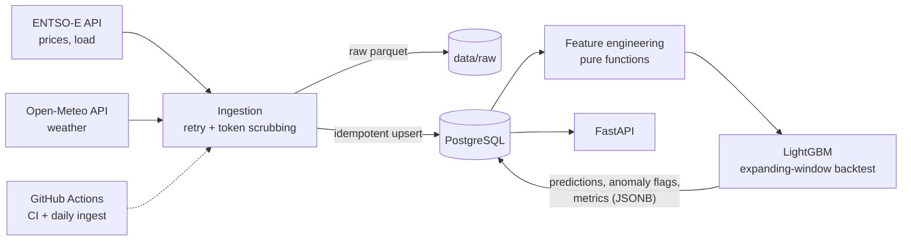

# nl-energy-pipeline

An end-to-end data pipeline on public Dutch energy data: it pulls day-ahead electricity prices and
grid load from [ENTSO-E](https://transparency.entsoe.eu/) plus weather from
[Open-Meteo](https://open-meteo.com/), stores everything in PostgreSQL, trains a LightGBM
price forecaster with a leakage-safe time-series backtest, flags anomalous price hours from the
forecast residuals, and serves the results through a FastAPI service. The whole thing is packaged
with Docker, tested in GitHub Actions against a real Postgres, and ingests new data on a schedule.



## Results

Backfilled 2024-01-01 to 2026-10-21 (about 175k raw rows: 52k price points, 98k load points, 25k hourly
weather rows) and trained on 24,422 complete hourly samples. Scores are **out-of-sample** from a 5-fold
expanding-window backtest (20,350 forecast hours, 2024-06 to 2026-10):

| Model | MAE (EUR/MWh) | RMSE (EUR/MWh) |
|---|---|---|
| **LightGBM** | **22.6** | **35.1** |
| Same hour yesterday | 27.4 | 43.6 |
| Same hour last week | 33.5 | 53.0 |

That is 17% lower MAE than "same hour yesterday" and 32% lower than "same hour last week". The most useful
features by gain are yesterday's price (42%), last week's price (17%) and wind speed (10%).

The anomaly detector flagged 365 of 20,350 hours (1.8%). The largest residuals are extreme price hours,
for example 2024-12-12 16:00 UTC (actual 873 vs. forecast 256 EUR/MWh) and 2026-05-01 11:00 UTC (actual -498
vs. forecast -28 EUR/MWh). Negative prices are common in the data (2,753 hours), so prices are modelled on
their natural scale rather than log-transformed.

## Quickstart

Requirements: Python 3.12+, [uv](https://docs.astral.sh/uv/), and a free
[ENTSO-E API token](https://transparency.entsoe.eu/) (only needed for ingestion).

### With Docker

```bash
cp .env.example .env                       # add ENTSOE_API_TOKEN
docker compose up --build -d               # Postgres + API (migrations run on start)
docker compose run --rm ingest             # last 7 days
docker compose run --rm ingest nl-energy-pipeline ingest --start 2024-01-01 --no-parquet   # full backfill
docker compose run --rm train
open http://localhost:8000/docs
```

### Without Docker

```bash
uv sync
cp .env.example .env                       # add ENTSOE_API_TOKEN
uv run python scripts/dev_db.py            # throwaway local Postgres, prints its DATABASE_URL
export DATABASE_URL=...                    # the URL printed above (or your own Postgres)
uv run alembic upgrade head
uv run nl-energy-pipeline ingest --start 2024-01-01
uv run nl-energy-pipeline train
uv run uvicorn nl_energy_pipeline.api.main:app
```

LightGBM needs the OpenMP runtime on macOS (`brew install libomp`).

### Development

```bash
uv run ruff check . && uv run ruff format --check .
uv run pytest                              # spins up a private Postgres automatically (pgserver)
```

## API

| Endpoint | Returns |
|---|---|
| `GET /health` | `{"status": "ok"}`, or 503 when the database is unreachable |
| `GET /prices?start&end&limit` | Day-ahead prices (EUR/MWh); defaults to the last 7 days |
| `GET /predictions?start&end&limit` | Out-of-sample forecast vs. actual price per hour |
| `GET /anomalies?start&end&limit` | Hours whose forecast residual was flagged as extreme |
| `GET /model` | Latest model version, training size and backtest metrics |

Timestamps are ISO-8601, naive values are read as UTC. Interactive docs are at `/docs`.

## Design decisions

| Decision | Why |
|---|---|
| **Store timestamps as UTC `timestamptz`; derive calendar features in `Europe/Amsterdam`** | Avoids DST ambiguity in storage and joins, while hour-of-day / holiday effects still follow local behaviour. |
| **Every write is `INSERT ... ON CONFLICT DO UPDATE`** | Re-running a window, retrying after a crash, or the daily job re-fetching the last 3 days can never duplicate rows; late-published values overwrite earlier gaps. |
| **Ingest month by month, commit per month** | A failure leaves earlier months intact; the retry is just "run the same command again". |
| **Retry only transient errors (5xx, timeouts); fail loudly otherwise** | A 599 from ENTSO-E killed a long backfill; a 401 or bad parameter should never be retried or swallowed. |
| **Scrub `securityToken=` from error messages** | ENTSO-E takes the token as a query parameter, and `requests` echoes the URL in exceptions, i.e. into logs. |
| **Resample everything to hourly** | ENTSO-E switched day-ahead prices to 15-minute resolution (Oct 2025) while load was already 15-minute and weather is hourly. |
| **Feature availability contract** | The model forecasts day D at 10:00 UTC on D-1: price lags >= 24 h, actual-load lags >= 48 h, weather assumed to be a forecast. All lags are tested against leakage. |
| **Expanding-window backtest with a 24 h gap and naive baselines** | Random k-fold leaks the future into training; a forecast is only worth something relative to "same hour yesterday / last week". |
| **Anomalies = trailing robust z-score of out-of-sample residuals** | Median/MAD over the previous 30 days: no look-ahead, and a spike cannot inflate its own threshold. |
| **Metrics and predictions live in Postgres, not on disk** | The API container stays stateless and deployable on any platform. |
| **Alembic migrations are what tests and CI run** | The schema that ships is the schema that is tested. |

## Tests and CI

44 tests (about 90% line coverage): pure-function unit tests (feature lags, leakage, DST/holiday handling, anomaly
detection), integration tests against a **real PostgreSQL** (idempotent upserts, migrations,
retraining, API), and ingestion tests with fake clients (no network).

GitHub Actions (`.github/workflows/`):

- **`ci.yml`**: ruff lint + format check, pytest with a Postgres service container and coverage,
  then a Docker build that checks the image starts and can import LightGBM.
- **`ingest.yml`**: daily scheduled run that re-ingests the last 3 days and retrains on Mondays.
  Needs the repository secrets `ENTSOE_API_TOKEN` and `DATABASE_URL`.

## Deployment (Railway)

`railway.json` points Railway at the `Dockerfile`; the container runs `alembic upgrade head` and
then serves on `$PORT`, with `/health` as the health check.

1. New Railway project -> deploy from this GitHub repo.
2. Add a PostgreSQL service and set `DATABASE_URL` on the app to the Postgres service's
   connection URL (plain `postgresql://...` URLs are accepted).
3. Load data once from your machine: `DATABASE_URL=<railway public url> uv run nl-energy-pipeline ingest --start 2024-01-01`, then `... train`.
4. Add the two secrets above to GitHub so the daily workflow keeps the database fresh.

## Limitations and next steps

- The backtest uses observed weather as a stand-in for a weather *forecast*, so the reported error is
  somewhat optimistic compared with true day-ahead operation.
- There is no `/forecast` for future hours yet; it would need an Open-Meteo forecast client.
- Docker and the deployment configuration are written to be run, but are validated in CI
  (image build + import check) rather than on a developer machine without Docker.
- Retraining is a scheduled batch job; there is no model registry or drift monitoring.
